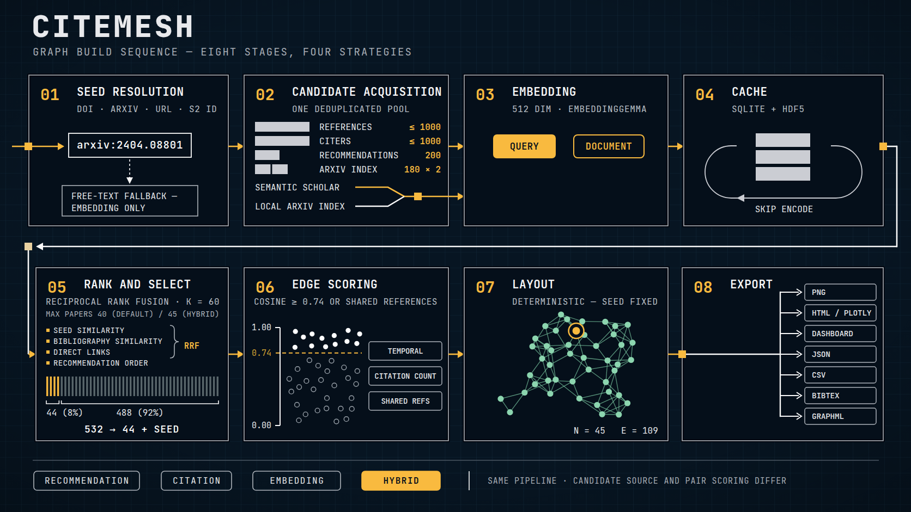

# CiteMesh

CiteMesh turns one paper you already know into a graph of the research around it: the newer papers that follow up on it, and the older foundational work it rests on.

CiteMesh uses local embeddings in its hybrid and embedding strategies to find and rank related papers. Candidates come from the focal paper's references and citers, Semantic Scholar recommendations, or an optional arXiv index. Graph edges represent similarity between papers. Export an interactive dashboard, graph data, bibliography, or image.

**[Explore the live demo](https://pszemraj.github.io/CiteMesh/)** to try the Megalodon dashboard in your browser without installing anything.


_A hybrid graph built around "Megalodon" that combines its references, citers, and Semantic Scholar recommendations with nearest neighbors from the 3.2-million-paper arXiv index (45 papers, 110 links). The selected paper, "Mega," ranks first. The "Why this paper" panel shows its similarity signals and a passage from the seven places where Megalodon cites it. **More papers** lists further references and arXiv matches that did not make the graph._

After cloning, open the [saved Megalodon dashboard](assets/examples/megalodon/dashboard.html) to explore a graph offline without installing CiteMesh. Its [collection package](assets/examples/megalodon/dashboard.citemesh.json) can be imported through the dashboard's [Add Results control](docs/reference/output-artifacts.md#dashboard-html).

## Quick start

Use Python 3.10 or newer and Git. Install a supported PyTorch build for your hardware first. CiteMesh runs embedding inference on CPU, CUDA, or Apple Silicon MPS. [PyTorch installation selector](https://pytorch.org/get-started/locally/) · [Supported versions](docs/reference/embedding-runtime.md#dependency-floor)

```bash
pip install "citemesh[recommended] @ git+https://github.com/pszemraj/CiteMesh.git"
citemesh --help
```

### Build a hybrid graph with local embeddings

```bash
citemesh build "arxiv:2404.08801" --strategy hybrid --export dashboard
citemesh view
```

This build needs no arXiv index. With the default candidate source, CiteMesh embeds the focal paper and candidates from Semantic Scholar on your machine. It ranks references, citing papers, and recommendations using local embeddings and citation evidence. The first build downloads about 1.2 GB of model weights. Later builds reuse cached vectors. [Embedding model](docs/reference/embedding-runtime.md#model-selection-and-fallback) · [Cache behavior](docs/guides/caching.md)

For a faster first hybrid build, append `--no-references` to skip the extra reference lookups used for edge scoring. You still get the same ranked reading list for the same candidate data.

The build writes `out/dashboard.html` and `out/dashboard.citemesh.json`. `citemesh view` opens the dashboard in your browser. Building another focal paper with `--export dashboard` adds it to the same collection. A build without `--export` writes a static PNG. [Output artifacts](docs/reference/output-artifacts.md#output-location)

Identify the focal paper with a DOI, an arXiv ID or URL, or a Semantic Scholar paper ID. To find one, run `citemesh search "attention mechanism transformers"`.

### Build a graph without PyTorch

For a model-free graph on CPU, install the `viz` extra and use Semantic Scholar recommendations.

```bash
pip install "citemesh[viz] @ git+https://github.com/pszemraj/CiteMesh.git"
citemesh --help
citemesh build "arxiv:1706.03762" --strategy recommendation --export dashboard
citemesh view
```

### Choose a strategy

| Strategy | Candidates come from | Needs the `embeddings` extra |
| --- | --- | --- |
| `recommendation` (default) | Semantic Scholar recommendations | no |
| `citation` | the focal paper's references and citers | no |
| `embedding` | Semantic Scholar candidates, or a downloaded arXiv corpus | yes |
| `hybrid` | the focal paper's references and citers plus Semantic Scholar recommendations or corpus neighbors, all ranked by [rank fusion](docs/guides/how-it-works.md#5-ranking-and-selection) | yes |

The `recommended` extra includes `embeddings` and `viz`. The `viz` extra adds dashboard, HTML, and Plotly exports. The base install supports citation and recommendation graphs with PNG, JSON, CSV, BibTeX, and GraphML exports. [Strategy guide](docs/guides/strategies.md)

### Optional arXiv corpus search

The precomputed index enables nearest-neighbor discovery across **3.2 million arXiv papers** using 512-dimensional int8 EmbeddingGemma vectors. Import it with the `embeddings` extra to skip corpus-wide encoding. The snapshot download is about **4 GB** and works without a Hugging Face login. Its native SQLite and HDF5 cache measured about **8.3 GB** on Linux. Budget space for both and the model weights. [Public arXiv index](https://huggingface.co/buckets/pszemraj/citemesh-arxiv-indexes)

```bash
citemesh cache import --bucket pszemraj/citemesh-arxiv-indexes --config embeddinggemma-512-int8
```

After import, run a hybrid build with the corpus enabled, or rerun the corpus command that prompted the import. Default model settings select this index automatically and use its full corpus.

```bash
citemesh search "long-context language models and efficient attention" --semantic-source arxiv-corpus --limit 5
citemesh build "arxiv:2404.08801" --strategy hybrid --semantic-source both \
  --export dashboard
```

Save `both` as the source for future hybrid builds with `citemesh config set defaults.semantic_source both`. Import checks your settings, including saved config defaults; when they do not select the index, as with non-default model settings, the commands it prints add `--cache-namespace NAMESPACE`.

Import needs no GPU or model weights. Queries and graph similarity use the index's pinned model on your local device, including CPU. On an installed index, `--corpus-size N` searches the newest N indexed papers while keeping the full download and cache on disk. [Portable corpus indexes](docs/guides/caching.md#portable-corpus-indexes)

### Encode a corpus locally

To encode your own corpus, select `--semantic-source arxiv-corpus` with an empty cache. CiteMesh processes the full selected split by default. For the entire arXiv split, expect a multi-gigabyte metadata download and a long encoding job even on a GPU. With `--corpus-size 10000`, CiteMesh scans the split to select the 10,000 newest papers before encoding. A `--dataset-split` slice such as `train[:2%]` bounds the rows it considers. [Corpus hydration](docs/guides/caching.md#corpus-hydration-and-resume)

```bash
citemesh build "arxiv:1706.03762" --strategy embedding --semantic-source arxiv-corpus --corpus-size 10000
```

### Commands

| Command | What it does |
| --- | --- |
| `citemesh build PAPER` | Build a graph from a paper ID, or from free text with `--strategy embedding`. |
| `citemesh search QUERY` | Find a focal paper by local semantic search or Semantic Scholar keyword search. |
| `citemesh view [PATH]` | Open a saved dashboard in a browser. |
| `citemesh cache` | `scan`, `clear`, `import`, `export`, and `refresh` the data CiteMesh stores. |
| `citemesh config` | Save personal defaults; see [user configuration](docs/guides/configuration.md). |

Every flag is in `citemesh COMMAND --help` and the [CLI guide](docs/guides/cli.md). Every key you can save as a default is in the [config reference](docs/reference/config/config_reference.toml), with an [example config](docs/reference/config/example.toml) to start from.

## Limits

- **Pre-1.0 public beta.** Export formats, cache layouts, and defaults may change between revisions. CiteMesh runs on macOS, Linux, and Windows.
- **Semantic Scholar sets the pace.** Focal paper lookup and most candidate collection go through its API, which rate-limits clients and can return HTTP 429. CiteMesh retries with backoff; [configure an API key](docs/guides/configuration.md#api-key) for steadier builds. Anonymous builds share a 90-second recovery budget, and a total outage fails a citation or hybrid build instead of emitting a graph containing only the focal paper ([retry policy](docs/guides/cli.md#troubleshooting)).
- **Thin provider coverage gives thin graphs.** Recommendation depends on what Semantic Scholar recommends for the focal paper. When it omits a focal paper's references, CiteMesh can [recover explicit identifiers from an available arXiv HTML bibliography](docs/guides/cli.md#missing-semantic-scholar-references).
- **Graphs are sparse by design.** Each paper keeps only its few strongest links (3 for recommendation and citation, 4 by default for embedding, 5 for hybrid), so the graph shows the closest relations rather than every one ([edge scoring](docs/guides/how-it-works.md#6-edge-scoring)).

## How it works



Follow the pipeline in [How CiteMesh builds a graph](docs/guides/how-it-works.md), choose a [strategy](docs/guides/strategies.md), or browse the [documentation index](docs/README.md).

## Contributing

Bug reports and feature requests are welcome via [issues](https://github.com/pszemraj/CiteMesh/issues). For an editable development checkout with the `all` extra, run `pip install -e ".[all]"`. Development setup and checks are in [AGENTS.md](AGENTS.md).

For demo updates and social preview verification, see [hosted demo maintenance](docs/internals/architecture.md#hosted-demo).

[](https://deepwiki.com/pszemraj/CiteMesh)

## License

MIT License. See [LICENSE](LICENSE).
