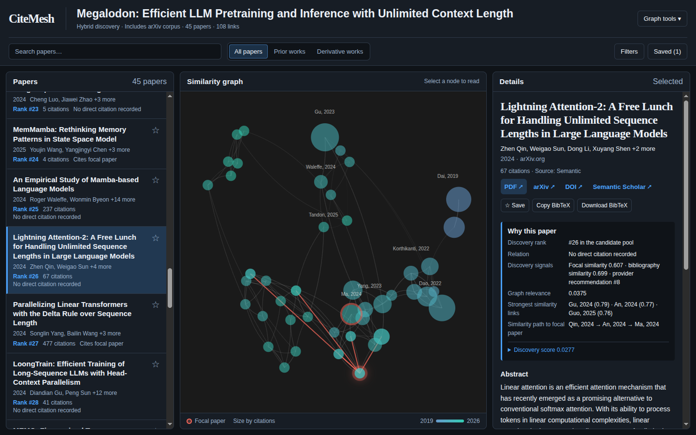

# CiteMesh

CiteMesh turns one paper you already know into a graph of the research around it: the newer papers that follow up on it, and the older foundational work it rests on.

It is a discovery tool, not a citation map. Candidates come from the seed's references and citers, Semantic Scholar recommendations, and embedding neighbors; edges are scored similarity rather than citation direction, and papers that are not relevant are left out even when they are cited. Run it locally with recommendation, citation, embedding, or hybrid discovery, then export an interactive dashboard, graph data, bibliography, or image.

**[Explore the live demo](https://pszemraj.github.io/CiteMesh/)** to try the Megalodon dashboard in your browser without installing anything.



_A hybrid graph seeded by "Megalodon" that combines its references, citers, and Semantic Scholar recommendations with nearest neighbors from the 3.2-million-paper arXiv index (45 papers, 108 links). "Lightning Attention-2" is selected: Megalodon does not cite it, but it was recommended and resembles the papers Megalodon cites, so it ranks 26th. Its evidence is shown under "Why this paper"._

After cloning, open the [saved Megalodon dashboard](assets/examples/megalodon/dashboard.html) to explore a graph offline without installing CiteMesh. Its [collection package](assets/examples/megalodon/dashboard.citemesh.json) can be imported through the dashboard's [Add Results control](docs/reference/output-artifacts.md#dashboard-html).

## Quick start

Python >= 3.10. There is no PyPI release yet, so install from GitHub. The embedding and hybrid strategies need PyTorch: install the build for your hardware first with the [official selector](https://pytorch.org/get-started/locally/), or pip may resolve a build you did not intend.

```bash
pip install "citemesh[recommended] @ git+https://github.com/pszemraj/CiteMesh.git"
citemesh --help
```

Extras: `embeddings` (embedding and hybrid strategies), `viz` (html, plotly, and dashboard exports), `recommended` (both), `all` (adds dev tooling). Without an extra, the citation and recommendation strategies export png, json, csv, bibtex, and graphml. For an editable development checkout, run `pip install -e ".[all]"`. Embedding dependencies and device requirements are in [Embedding Runtime](docs/reference/embedding-runtime.md#dependency-floor).

### Build a graph

```bash
citemesh build "arxiv:1706.03762" --export dashboard
citemesh view
```

The first command builds from Semantic Scholar recommendations, the default strategy, and writes `out/dashboard.html` (a viewer that opens from the local filesystem) and `out/dashboard.citemesh.json` (the data package behind it). `citemesh view` opens the dashboard in your browser. Building another seed with `--export dashboard` adds it to the same collection. Without `--export`, a build writes a static PNG. See [Output Artifacts](docs/reference/output-artifacts.md#output-location) for output naming and collections.

The seed can be a DOI, an arXiv ID or URL, or a Semantic Scholar paper ID. To find one, run `citemesh search "attention mechanism transformers"`.

### Choose a strategy

| Strategy | Candidates come from | Needs the `embeddings` extra |
| --- | --- | --- |
| `recommendation` (default) | Semantic Scholar recommendations | no |
| `citation` | the seed's references and citers | no |
| `embedding` | Semantic Scholar candidates, or a downloaded arXiv corpus | yes |
| `hybrid` | the seed's references and citers plus Semantic Scholar recommendations or corpus neighbors, all ranked by [rank fusion](docs/guides/how-it-works.md#5-ranking-and-selection) | yes |

```bash
# Semantic Scholar recommendations (the default)
citemesh build "arxiv:1706.03762"

# Rank the seed's references, citers, and S2 recommendations with local embeddings
citemesh build "arxiv:1706.03762" --strategy hybrid --export all

# Embedding search over a downloaded arXiv corpus
citemesh build "arxiv:1706.03762" --strategy embedding --semantic-source arxiv-corpus
```

`--semantic-source arxiv-corpus` swaps Semantic Scholar's candidates for the seed's nearest neighbors in a downloaded arXiv corpus; hybrid still takes the seed's references and citers from Semantic Scholar. The first semantic build downloads the [embedding model](docs/reference/embedding-runtime.md#model-selection-and-fallback), and later runs [reuse stored vectors](docs/guides/caching.md). The [strategy guide](docs/guides/strategies.md) compares them in detail.

### Reuse the public arXiv index

Skip encoding the corpus yourself: the [public precomputed index](https://huggingface.co/buckets/pszemraj/citemesh-arxiv-indexes) contains **3.2 million arXiv papers** with 512-dimensional int8 EmbeddingGemma vectors. Download its vectors and paper metadata without a Hugging Face login:

```bash
citemesh cache import --bucket pszemraj/citemesh-arxiv-indexes --config embeddinggemma-512-int8
```

Replace `NAMESPACE` below with the namespace printed by import, then search or build from the installed corpus:

```bash
citemesh search "long-context language models and efficient attention" --mode local --cache-namespace NAMESPACE --all-corpus --limit 5
citemesh build "arxiv:2610.26830" --strategy embedding --cache-namespace NAMESPACE --all-corpus
```

Import needs no GPU or model weights. Queries and graph similarity still use the index's pinned embedding model locally. See [portable corpus indexes](docs/guides/caching.md#portable-corpus-indexes) for storage, selection, and resume details.

### Commands

| Command | What it does |
| --- | --- |
| `citemesh build PAPER` | Build a graph from a paper ID, or from free text with `--strategy embedding`. |
| `citemesh search QUERY` | Find a seed paper by local semantic search or Semantic Scholar keyword search. |
| `citemesh view [PATH]` | Open a saved dashboard in a browser. |
| `citemesh cache` | `scan`, `clear`, `import`, `export`, and `refresh` the data CiteMesh stores. |
| `citemesh config` | Save personal defaults; see [user configuration](docs/guides/configuration.md). |

Every flag is in `citemesh COMMAND --help` and the [CLI guide](docs/guides/cli.md). Every key you can save as a default is in the [config reference](docs/reference/config/config_reference.toml), with an [example config](docs/reference/config/example.toml) to start from.

## Limits

- **Pre-1.0 public beta.** Export formats, cache layouts, and defaults may change between revisions. CiteMesh runs on macOS, Linux, and Windows.
- **Semantic Scholar sets the pace.** Seed lookup and most candidate collection go through its API, which rate-limits clients and can return HTTP 429. CiteMesh retries with backoff; [configure an API key](docs/guides/configuration.md#api-key) for steadier builds. Anonymous builds share a 90-second recovery budget, and a total outage fails a citation or hybrid build instead of emitting a seed-only graph ([retry policy](docs/guides/cli.md#troubleshooting)).
- **Thin provider coverage gives thin graphs.** Recommendation depends on what Semantic Scholar recommends for the seed. When it omits a seed's references, CiteMesh can [recover explicit identifiers from an available arXiv HTML bibliography](docs/guides/cli.md#missing-semantic-scholar-references).
- **Graphs are sparse by design.** Each paper keeps only its few strongest links (3 for recommendation and citation, 4 by default for embedding, 5 for hybrid), so the graph shows the closest relations rather than every one ([edge scoring](docs/guides/how-it-works.md#6-edge-scoring)).
- **Semantic strategies need a model and hardware.** They download the embedding model on first use, and encoding all 3.2M arXiv papers yourself is a long GPU job, which is why the precomputed index exists. That index covers arXiv papers only.

## How it works


Follow the pipeline in [How CiteMesh builds a graph](docs/guides/how-it-works.md), choose a [strategy](docs/guides/strategies.md), or browse the [documentation index](docs/README.md).

## Contributing

Bug reports and feature requests are welcome via [issues](https://github.com/pszemraj/CiteMesh/issues). Development setup and checks are in [AGENTS.md](AGENTS.md).

[](https://deepwiki.com/pszemraj/CiteMesh)

## License

MIT License. See [LICENSE](LICENSE).
