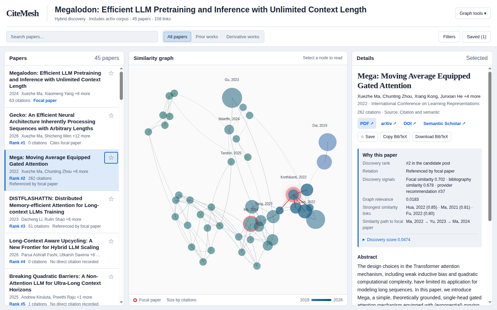

# CLI usage guide

`citemesh build` creates a graph; `search` finds focal papers, `view` opens results, `cache` manages persisted data, and `config` saves defaults. See [installation](../../README.md#quick-start) and the [build pipeline](how-it-works.md).

## Common workflows

### Build a graph

```bash
# Hybrid dashboard with local embeddings for Semantic Scholar candidates
citemesh build "arxiv:2404.08801" --strategy hybrid --export dashboard
citemesh view

# Add a model-free recommendation graph to the same dashboard collection
citemesh build "arxiv:1810.04805" --strategy recommendation --export dashboard

# Minimal citation graph (static PNG, the default export)
citemesh build "arxiv:1706.03762" --strategy citation -p 20

# Standalone single-file dashboard
citemesh build "arxiv:1706.03762" -s hybrid -e dashboard -o out/report.dashboard.html

# Encode and search a corpus slice, with a debug trace
citemesh build "arxiv:1810.04805" -s embedding --dataset-split "train[:2%]" \
  -e plotly --verbose --log-file out/run.log
```

Without `--export`, a build writes a static PNG. The `html`, `plotly`, and `dashboard` exports need the `viz` extra, included in the [hybrid quick start](../../README.md#quick-start). Output directories, standalone files, and collection updates follow the [output-location rules](../reference/output-artifacts.md#output-location).

### Accepted identifiers

- DOI, bare or with a `doi:` prefix or `doi.org` URL; prefixed and URL forms normalize to lowercase, while a bare DOI keeps its input case
- arXiv ID or URL (`arxiv:1706.03762`, `https://arxiv.org/abs/1706.03762`, `.../pdf/1706.03762.pdf`), `vN` suffixes normalized away; bare `1706.03762` works when S2 resolves it
- Semantic Scholar paper ID
- Free-form text under `--strategy embedding`, when S2 says the input is not a known paper (outages stay errors)

### Find a focal paper

```bash
citemesh search "attention mechanism transformers" --limit 5
citemesh build "<paper-id-from-search>" --strategy hybrid --export dashboard
# search what an arXiv-corpus build hydrated
citemesh search "long-context attention" --semantic-source arxiv-corpus
```

Search modes:

- `local` encodes the query and ranks it against cached retrieval-document vectors, returning cosine scores and full paper IDs. It fetches no paper metadata and fails if the selected cache is empty.
- `s2` performs Semantic Scholar keyword search and returns citation counts. Requests above 100 results are paginated, up to the service's 1,000-result relevance limit. Local search accepts any positive limit.
- `auto` tries local search first and falls back to S2 when the selected cache is empty or local dependencies or model loading are unavailable, logging the reason. An installed corpus that is unusable exits with status 1 instead of falling back. Causes: a pending import or refresh, uncertified membership, a requested view larger than the installed coverage, a source or runtime mismatch, or a model-fingerprint mismatch. Resume the pending operation or select matching settings before retrying.

Searching an installed portable index:

- `--cache-namespace NAMESPACE` selects the index directly. Its fixed model and source settings override unrelated saved defaults, and explicit conflicts are usage errors (exit 2).
- This selection never falls back to S2, including under `--mode auto`.
- Without it, search reads the namespace derived from the current model settings. That reaches an installed index only when those settings match its fixed ones; the default `candidates` source never does.
- Search skips model loading and cache creation when stored metadata rules out every namespace. When the selected namespace is empty, the `auto` fallback warning and the `--mode local` error name any installed corpora with a `--cache-namespace` command.
- For fixed settings, corpus views, and recovery, see [Portable corpus indexes](caching.md#portable-corpus-indexes).

Local search derives its namespace from the [saved embedding settings](../reference/config/config_reference.toml). Override them with `--model`, `--model-profile`, `--model-revision`, `--device`, `--semantic-source`, `--dataset-source`, `--truncate-dim`, `--storage-precision`, or `--calibration-sample-size`. A selector implies local mode unless `--mode auto` is explicit; selectors conflict with `--mode s2`. Invalid explicit option combinations fail as usage errors instead of triggering fallback.

Other search behavior:

- `--dataset-source` implies `arxiv-corpus` unless paired with a conflicting explicit source.
- Local results include the searched count and a copyable build command. When saved settings select an installed index, it is a hybrid build with `--semantic-source both` and no namespace. When the search passed `--cache-namespace` or a model or dataset selector, the command repeats the namespace and corpus view. The command is omitted with a warning if the cache has no recorded split.
- [API key configuration](configuration.md#api-key) and the [request policy](#troubleshooting) apply when search uses S2.

### View a saved dashboard

`citemesh view [PATH]` opens a saved HTML export in a browser without rebuilding or starting a server. `PATH` defaults to `out/dashboard.html`; a directory resolves to its `dashboard.html`, and an explicit `.html`/`.htm` file works. A missing dashboard, non-HTML input, or failed launch exits `1`.

```bash
citemesh view
citemesh view out/my-collection
# pick a browser
citemesh view out/report.dashboard.html --browser google-chrome
```

### Save defaults, inspect the cache

```bash
citemesh config set defaults.semantic_source arxiv-corpus
citemesh cache scan
```

See [User Configuration](configuration.md) for saved defaults and [cache maintenance](caching.md#inspecting-and-clearing) for scan and reset behavior.

### Install, export, and refresh a corpus index

See [Portable corpus indexes](caching.md#portable-corpus-indexes) for the commands and their import, export, refresh, selection, and recovery behavior.

### Missing Semantic Scholar references

Hybrid builds request up to `--max-references` references from the focal paper through Semantic Scholar (1000 by default; `--max-references 0` turns reference discovery off) and rank every reference returned together with the other candidates. `--no-references` does not turn discovery off: it only skips the later fetch of the selected papers' reference lists used for bibliographic coupling. A retrieved reference that enters through another source still carries its known relationship to the focal paper.

If Semantic Scholar returns no usable references for the focal paper or reference discovery is unavailable, CiteMesh tries the focal paper's arXiv HTML bibliography when it has an arXiv ID. This applies to citation, hybrid, and embedding candidate collection. It recovers outgoing references, while incoming citations need Semantic Scholar. It requires no PDF/LaTeX extraction or extra dependency. Corpus-only embedding search does not fetch HTML.

What recovery matches:

- Explicit arXiv IDs and DOIs in bibliography entries. Available local metadata is resolved before S2, and arXiv's metadata API resolves the remaining arXiv IDs.
- Entries without explicit identifiers, only when S2 returned an empty reference list and hybrid has a prepared corpus: a unique corpus paper with the same normalized title, full first-author name, and year. An arXiv preprint may be one year earlier than the bibliography's publication year; multiple matches across either year remain unresolved. This lookup scans the active corpus metadata once and makes no additional metadata API requests.

How recovered references are used:

- They compete under the existing reference and total-paper limits. Hybrid puts every recovered reference into the candidate pool up to the reference limit, where it is ranked like any other candidate; only a bibliography larger than the limit is cut first, by title and abstract similarity to the focal paper and then citation count.
- A supplied arXiv version selects that HTML version, while graph identities remain version-independent.
- Partial recovered lists are not used for shared-reference scoring or stored as complete S2 reference lists.

### Help and console output

Every command takes `-h`/`--help`, listing built-in defaults; [user configuration](configuration.md) shows how to inspect saved overrides. `--log-width` sizes result tables and logs but never help; [environment variables](../reference/environment.md#other-respected-variables) control color. Logs go to stderr.
Log lines carry local `HH:MM:SS` timestamps. Builds show the resolved focal title and year when available. The completion summary gives total elapsed time including export, followed by one copyable path per output. Progress rows show the same clock where width permits, recording the last completed-count advance or the task's start before its first increment.
Redirected logs use plain text without terminal padding or forced line breaks, unless you set `--log-width` or force color.
The first Semantic Scholar request reports keyed or anonymous access and local pacing. Debug output names the credential source without displaying the key.

`-v`/`--verbose` is shorthand for `--log-level debug`; it works before or after a subcommand. When several verbosity options are present, the last one wins. `--log-level debug --log-file out/run.log` adds option routing, cache and provider details, runtime configuration, retry attempts, and namespace decisions.

| Level | Output |
| --- | --- |
| `error` | The requested operation failed. |
| `warning` | A result was materially degraded or an explicitly requested runtime feature could not be used. |
| `info` | Brief build phases, useful outcomes, and saved output locations. |
| `debug` | Cache, provider, runtime, and scoring diagnostics for development. |

Progress bars appear by default on an interactive terminal at `info` or `debug`, covering paper discovery, corpus queries, embedding batches, reference recovery, and reference enrichment. Provider listings with unknown totals show the completed count against `?`. Narrow terminals prioritize counts and ETA. Search results place year and score or citation count beneath each paper on narrow terminals, while keeping full paper IDs on their own lines.
After the first Semantic Scholar retry, interactive terminals show a running section count and any backoff wait in the section's progress row or a temporary line. When the section ends, one `info` summary reports total retries, rate-limited retries, and elapsed time. Redirected output also retains `info` notices for waits beyond normal pacing. At `debug`, individual retry attempts are logged; responses also show the endpoint, status, elapsed time, and whether the authentication header was present. The key itself is omitted.

## Option reference

Use `citemesh COMMAND --help` for the current flags, defaults, accepted values, and command examples. Build options are strategy-scoped: an explicit flag unsupported by the selected strategy is a CLI error, while [configured defaults](configuration.md#precedence) follow their documented applicability rules.

Behavior that needs more context than command help lives in [Strategies](strategies.md), [Caching and Data](caching.md), [Embedding Runtime](../reference/embedding-runtime.md), and [Output Artifacts](../reference/output-artifacts.md). The sweeps behind tuned embedding defaults live in [Defaults Tuning Study](../reference/defaults-tuning-study.md).

### Export formats

Formats, dashboard collection and standalone behavior, package schemas, sidecars, and determinism notes: [Output Artifacts](../reference/output-artifacts.md). Interactive exports need the [viz extra](../../README.md#quick-start).



_`--theme light` with a paper selected._

## Troubleshooting

Semantic Scholar request policy

- **Pacing.** The client spaces authenticated requests at least 1.2 seconds apart and anonymous requests at least 2 seconds apart, within Semantic Scholar's published per-key rate. A `Retry-After` duration or HTTP date delays every later request through the same client.
- **Retries.** Each failed page or batch gets up to 30 attempts and retries only itself. Semantic Scholar answers a large share of keyed and anonymous requests with HTTP 429 at times, and in measurements that share did not fall with waits from 1 to over 60 seconds, so a 429 without `Retry-After` retries at the next pacing slot. Server errors, HTTP 408, and connection failures back off from 4 seconds, doubling per attempt of that request to a 300-second cap. A request that exhausts its attempts stops later uncached requests in its section. Focal metadata, focal references, focal citations, recommendations, keyword search, metadata for arXiv bibliography recovery, selected paper metadata, and reference hydration are separate sections.
- **Timeouts.** HTTP connect and read timeouts default to 30 seconds; retries shorten them to the remaining recovery time limit when one is set. These are not wall-clock deadlines. Bad parameters and rejected credentials fail immediately.
- **Recovery time limit.** Set `--s2-retry-budget SECONDS`, for example `--s2-retry-budget 60`, to cap the time spent recovering in each section. Failed requests, retries, and recovery waits count toward the limit. Healthy first requests, embedding work, and rendering are excluded. The default `0` leaves only the attempt limit. An in-flight request may run past the time limit.

A request rejected only with HTTP 429 costs about one pacing interval per retry. Persistent server errors can wait about two hours per request before its attempts run out; set a recovery time limit to stop sooner. The measurements behind this policy are in [Semantic Scholar request policy](../internals/semantic-scholar-requests.md).

Common symptoms:

- **No results / paper not found**: check the identifier format and S2 availability.
- **Discovery check unavailable**: required acquisition failure exits nonzero without replacing prior outputs; retry later, [configure an API key](configuration.md#api-key), or use the local `arxiv-corpus` semantic source, which requires the embeddings extras and a downloaded, embedded corpus. The error identifies the operation, HTTP failure when available, attempts, recovery time, and stopping reason.
- **Partial outage.** Citation and hybrid builds can continue when at least one requested source completes or returns a valid empty result. When a request exhausts its attempts, its section stops making uncached requests. Other sections keep running. Optional enrichment keeps successful results and available cached data. Exports mark each source `complete`, `empty`, or `unavailable`. If all requested sources are unavailable, the build exits nonzero.
- **Slow first embedding run**: see [hydration and resume](caching.md#corpus-hydration-and-resume).
