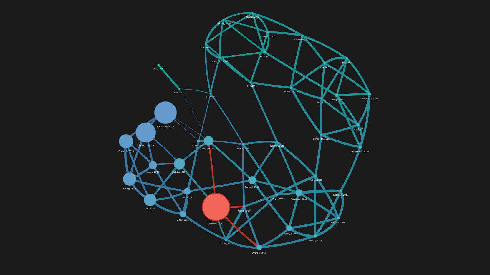
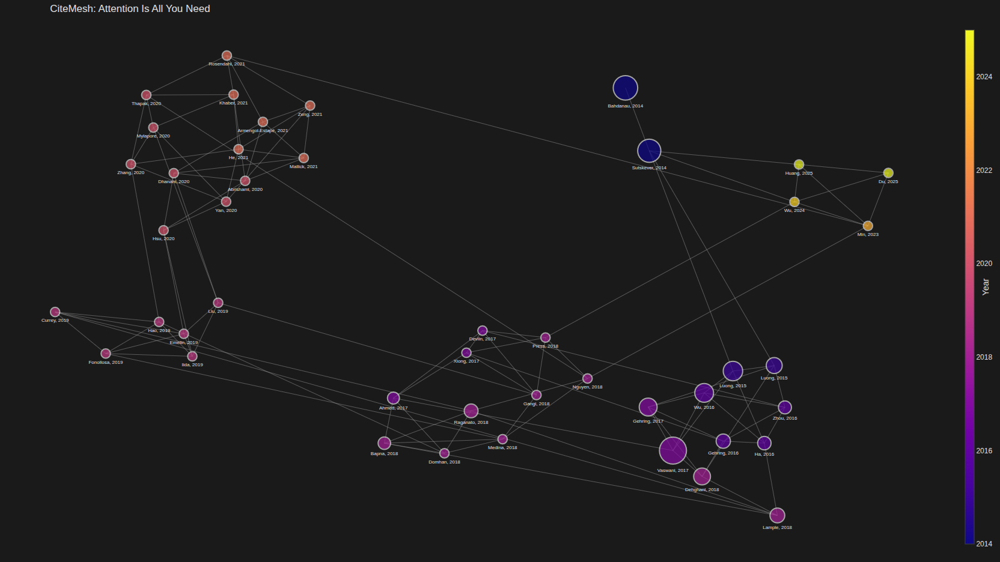
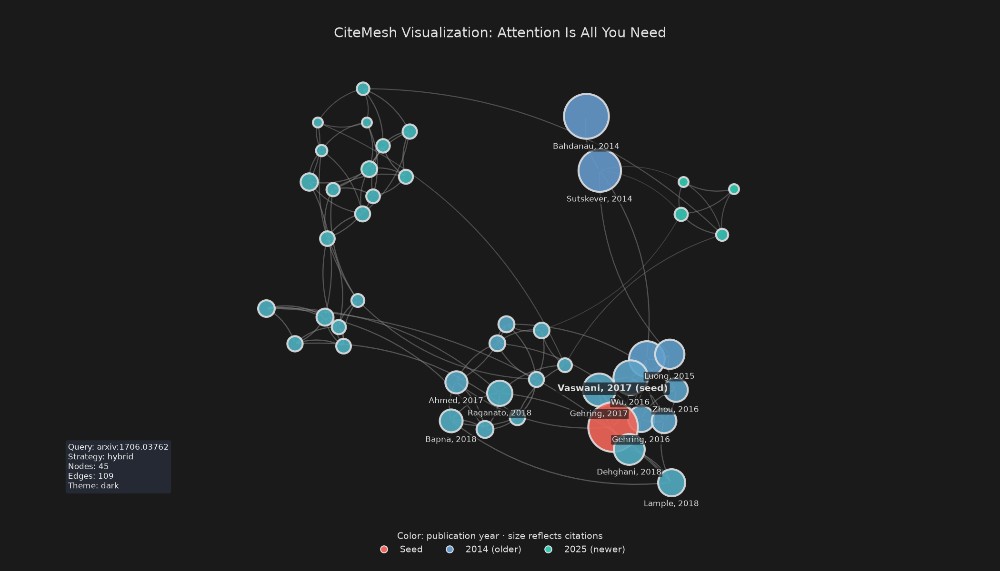
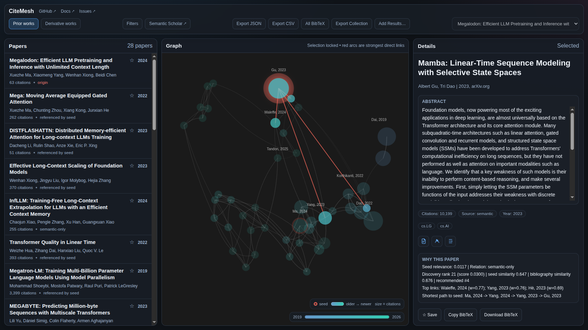
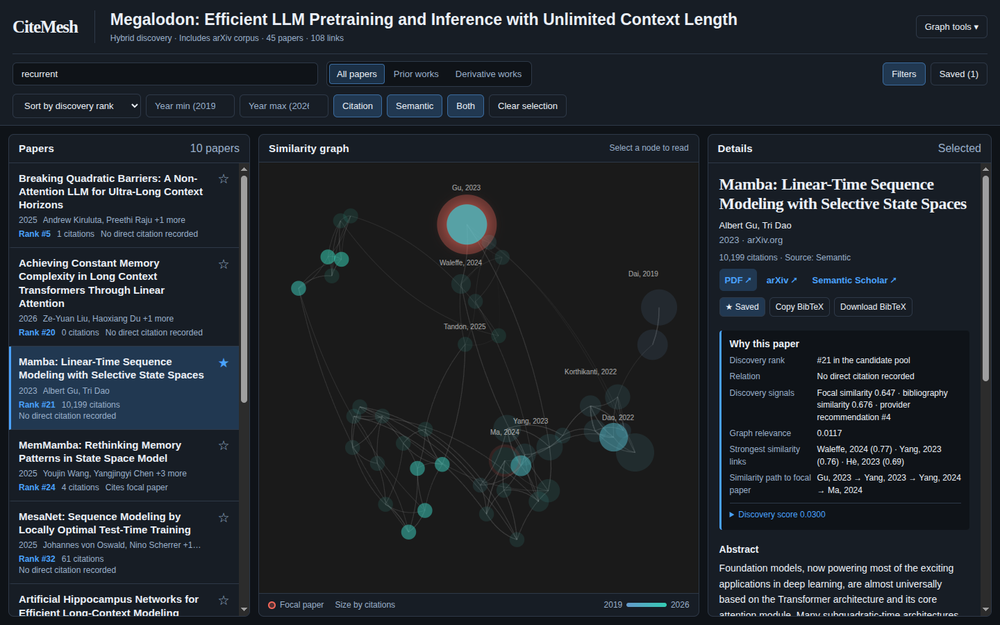

# Output artifacts

File names, path resolution, and the schema of every format CiteMesh writes. Dashboard runs maintain one reusable viewer plus one versioned data package per collection, not a dashboard per focal paper.

## Terminology

The **focal paper** is the paper a graph is built around. The graph stores its ID in `focal_id` and marks its node with `is_focal`. The CLI option `--seed` sets the random layout seed.

Graph JSON, dashboard collections, and build sidecars now use schema version 2. Version 1 used `seed_id`, `is_seed`, and `seed_*` field names. To use a version 1 graph, collection, or earlier `dashboard.manifest.json` with the current viewer, rerun the original builds in a new output directory. Existing self-contained HTML dashboards still open on their own. Scripts that read CSV headers or GraphML node attributes must also use the new field names.

## Artifact set

A dashboard run writes two shared files at the collection root, and sharing a finished collection needs only those two:

- `dashboard.html` - reusable tri-pane viewer with an embedded snapshot, so it opens from the local filesystem
- `dashboard.citemesh.json` - authoritative, portable package holding one or more graph results and their build settings

A hidden `.dashboard.citemesh.json.lock` beside the package serializes collection updates and viewer refreshes, including builds using different `CITEMESH_CACHE_DIR` roots (60-second timeout).

Every collection build also writes a directory `<title-slug>-<hash>/` for the focal paper, holding `<strategy>.json` and `<strategy>.config.json`, even under `--export dashboard` alone. Other formats are written when selected; `png` is the default when `--export` is omitted.

- `<strategy>.png` - static Matplotlib render
- `<strategy>.html` - Pyvis interactive network; self-contained, with vis-network inlined, so it opens offline and needs no sibling asset folder
- `<strategy>.plotly.html` - Plotly interactive graph; self-contained, filling the browser window in the export theme
- `<strategy>.json` - enriched graph payload
- `<strategy>.csv` - flat paper table
- `<strategy>.bib` - combined BibTeX entries
- `<strategy>.graphml` - Gephi/Cytoscape exchange format
- `<strategy>.config.json` - run config + metadata sidecar

The sidecar is always written except for a standalone-only `--export dashboard -o *.dashboard.html` run, and `--export json` never duplicates the graph JSON a dashboard build already wrote. Every artifact goes to a temporary file first and is published by atomic replacement, so a failed writer or post-processing step leaves the existing file in place.

The same hybrid graph through the three non-dashboard renderers:

| Pyvis (`--export html`) | Plotly (`--export plotly`) | Static PNG (`--export png`) |
| --- | --- | --- |
|  |  |  |

_Pyvis settles under browser physics and labels every node; Plotly keeps the Python layout but uses its own year colorbar and labels every node; the PNG adds a run-info box._

## Output location

Omit `--output` to use `out/` under the current working directory; a source checkout tracks `out/.gitkeep` and ignores generated contents. `<title-slug>` is a filesystem-safe paper title, falling back to the canonical focal paper ID, and `<hash>` is the first 8 characters of `sha256(focal_id)`. Later builds reuse a directory with the same hash suffix, so correcting a title keeps the directory name and lets a refresh replace its exports in place.

- `--output` omitted: non-dashboard artifacts go to `out/<title-slug>-<hash>/<strategy>.<ext>`; a dashboard export writes `out/dashboard.html`, `out/dashboard.citemesh.json`, and `out/<title-slug>-<hash>/<strategy>.json` plus its sidecar.
- An existing `--output` directory wins over suffix rules, even when its name ends in `.json` or `.dashboard.html`: non-dashboard exports go inside it, dashboard exports use it as the collection root.
- `-o out/report.dashboard.html` selects standalone mode: that one self-contained file, no collection package. In a multi-export run it also disables collection mode and gives siblings the stripped base plus their own suffixes (`out/report.json`, `out/report.csv`, `out/report.config.json`).
- Any other `--output` is a directory base, a known export suffix stripped first. Under collection mode the viewer and package sit at that root, every other format under `<base>/<title-slug>-<hash>/`. A single non-dashboard export to a non-directory target keeps a matching suffix, replaces a different known one, and appends a missing one.

The sidecar follows the resolved output: `<strategy>.config.json` beside strategy-named outputs, or the output stem otherwise (`out/report.json` -> `out/report.config.json`). Open the result with [citemesh view](../guides/cli.md#view-a-saved-dashboard).

## Collection package (`dashboard.citemesh.json`)

UTF-8 JSON with `kind: "citemesh-dashboard-collection"`, `schema_version: 2`, `current_result_id`, and `results` ordered most-recently-updated first. Each result holds its stable identity, a summary of the focal paper, title, and strategy, an `updated_at` timestamp, the graph payload, and portable `build` settings. Machine-local output paths are excluded, so the package moves between machines as one file.

Results are keyed by `(strategy, focal_id)`: a new focal paper adds a result, the same focal paper under a different strategy adds a separate one, and the same focal paper and strategy replaces that slot even when model or build settings changed - collections keep no history of reruns. A refresh also drops optional formats for that strategy that an earlier run produced and this one did not select; other strategies' and unrelated user files are untouched.

A malformed, unsupported, or inaccessible existing package stops the build before any API call or model work and leaves the file untouched; failed filesystem inspection never counts as a missing package. Per-result files are staged before the collection lock is taken and the package is written last, so an export, rendering, or filesystem failure leaves the previous collection intact and reports the saved package path - short of power-loss atomicity across the bundle.

## Graph JSON (`<strategy>.json`)

The graph payload requires its `focal_id` to identify a node present in the graph. It contains:

- `kind` (`"citemesh-graph"`), `schema_version` (`2`), `focal_id`
- `meta` - `strategy`, `year_range` (`{"min": ..., "max": ...}` over papers with a known year, `null` when none has one), and `candidate_source_status` when the build queried Semantic Scholar sources. Hybrid builds also include `discovery_ranker`, which describes how the papers were ranked: `{"method": "reciprocal_rank_fusion", "k": 60, "lists": [...]}`, where `lists` names the active lists. Optional `weights` records contributions that differ from one. For example, `{"focal_reference": 0.5}` gives focal citation use half weight. [Ranking formula](../guides/how-it-works.md#5-ranking-and-selection)
- `summary` - `nodes`, `edges`
- `nodes` - enriched per-paper objects
- `dashboard` - render metadata and stored layout geometry, always present
- `edges` - `source`, `target`, `weight`, plus readable `*_title` and `*_label` fields; `source`/`target` are the canonical node IDs, the readable fields are for inspection only

Each node carries:

- core fields `id`, `title`, `year`, `authors`, `abstract`, `citation_count`, `venue`, `arxiv_id`, `doi`, `categories`, `is_focal`, `is_local_corpus`; `year` is `0` when unknown, and those papers drop out of `meta.year_range`
- analysis fields `provenance` (`focal`/`citation`/`semantic`/`both`), `provenance_base`, `focal_relation` (`cites_focal`/`referenced_by_focal`/`semantic_only`/`overlap`/`focal`), and [`focal_relevance`](../guides/how-it-works.md#8-exports-and-the-dashboard-collection)
- `links` (arXiv abs/pdf, DOI, Semantic Scholar URLs) and a deterministic `bibtex` entry
- discovery evidence on every related paper of a hybrid build (never on the focal paper or on other strategies' papers): `discovery_rank` (one-based position in the fused order of the whole candidate pool), `discovery_score` (the fused score), `discovery_features`, and `discovery_list_ranks`

`discovery_features` holds `focal_similarity` (the document-role cosine with the focal paper), `bibliography_similarity` (`null` when fewer than five other references from the focal paper exist), `direct_citation` (the focal paper cites the paper or it cites the focal paper), and `recommendation_rank` (its position among the provider's returned recommendations, or `null`). `discovery_list_ranks` gives the paper's one-based position in each list named by `meta.discovery_ranker.lists`, or `null` for a list that does not contain it. The fused score uses these positions. The recommendation list position can differ from the provider position after candidates are deduplicated. The values below are illustrative:

```json
"discovery_rank": 3,
"discovery_score": 0.0479,
"discovery_features": {"focal_similarity": 0.71, "bibliography_similarity": 0.66, "direct_citation": true, "recommendation_rank": null},
"discovery_list_ranks": {"semantic": 5, "reference_context": 2, "direct": 1, "recommended": null}
```

`focal_relevance` is personalized PageRank over the final similarity graph. The dashboard labels it **Graph relevance**. The dashboard defaults to **Discovery rank** when every related paper has a rank, and **Graph relevance** otherwise. When ranks exist for only some papers, sorting by discovery rank puts unranked papers last. **Why this paper** shows the paper's place in the candidate pool, its discovery signals, and the separate graph evidence. Expand **Discovery score** to see the positions used in fusion. **Add Results** resets the sort, search, year, and scope controls for the loaded graph.

A selected focal reference can carry `focal_reference_evidence`. Its `context_count` counts distinct nonempty passages supplied by Semantic Scholar, `excerpt` holds a sample passage when available, and `is_influential` records the provider flag when supplied. These fields refer to the relationship with this particular focal paper.

**More papers** opens additional reading suggestions beyond the graph. The optional `meta.discovery_leads.references` list contains omitted focal references with at least two reported citation passages, ordered by fused discovery rank. The `corpus` list contains omitted papers found only by the arXiv index, ordered by the focal query’s native retrieval rank. Each list uses at most the graph’s requested related-paper budget. Entries carry a title, identifiers and original rank. Only `nodes` and `edges` define the graph.

JSON and dashboard share this node schema, and every JSON export carries the layout geometry (`dashboard.meta.plotly_*`), so any `citemesh-graph` file loads back into a dashboard through **Add Results** intact.

## CSV (`<strategy>.csv`)

Columns, one row per paper: `id`, `title`, `year`, `authors` (semicolon-separated), `citation_count`, `venue`, `arxiv_id`, `doi`, `categories` (semicolon-separated), `is_focal`, `provenance`, `focal_relation`, `focal_relevance`, `arxiv_url`, `doi_url`, `semantic_scholar_url`, `abstract`.

An empty graph still writes the header. Both the CLI and dashboard writers quote fields containing commas, quotes, or line breaks, and prefix an apostrophe to text cells beginning with `=`, `+`, `-`, `@`, tab, or carriage return (spreadsheet formula-injection guard), so consumers may see a leading `'`.

## BibTeX (`<strategy>.bib`)

One `@article` per paper, with `title`, `author`, `year`, `doi`, `url`, and `abstract` when available. `doi` and `url` are written verbatim rather than LaTeX-escaped so resolvers receive usable values - `doi` is the raw identifier, `url` the percent-encoded `https://doi.org/...` link - and all other fields are escaped. Citation keys combine a readable paper-ID slug with a stable ID-derived suffix, so IDs differing only in punctuation or case stay distinct. An empty graph produces an empty bibliography.

## GraphML (`<strategy>.graphml`)

A reduced node schema: `provenance`, `provenance_base`, `focal_relation`, `focal_relevance`, the four `discovery_*` fields (`discovery_rank`, `discovery_score`, `discovery_features`, `discovery_list_ranks`), `links`, and `bibtex` are omitted, `authors` and `categories` are flattened to comma-separated strings, `is_focal` is written as `0`/`1`, and nullable text fields become empty values. Graph-level attributes are `citemesh_graphml_determinism`, `citemesh_graphml_writer_version`, and one `citemesh_meta_<key>` per run-metadata key.

## Dashboard HTML

`dashboard.html` in collection mode, `<name>.dashboard.html` standalone: a tri-pane interface with an embedded Plotly graph, paper list, and detail panel. Collection-mode HTML embeds a package snapshot because browsers do not reliably let a `file://` page fetch adjacent local files; the package itself stays authoritative.

The header names the focal paper, discovery strategy, and graph size. When recorded in a build, it also identifies an arXiv corpus that supplied candidates and any requested source that was unavailable. Search titles, authors, and abstracts from the search box. On a narrow screen, use **Graph**, **Papers**, and **Details** to switch panels. Typing a query shows matching papers, and selecting a paper opens its details.



**Prior works** includes papers the focal paper references. **Derivative works** includes papers that cite it. For papers without a recorded direction, CiteMesh uses the publication year relative to the focal paper. The focal paper, papers with links in both directions, and undirected papers with unknown years appear in both views. Choose **All papers** to return to the full scope.

The paper list shows discovery rank where available. Select a title to read its abstract, open its source, and inspect **Why this paper**. A missing direct citation in the collected data can reflect incomplete provider coverage.

- **Filters** changes the sort order, publication years, and candidate sources.
- **Saved** shows papers you have starred in this graph.
- **Graph tools** contains the graph selector for collections, project links, and the Semantic Scholar shortcut for the selected or focal paper. **Export JSON**, **Export CSV**, and **All BibTeX** download the active graph. **Saved BibTeX** and **Copy Saved Links** appear after you star a paper.
- **Add Results** in Graph tools imports graph JSON, collection packages, or dashboard HTML. It updates matching graph slots in the current browser session. Use **Export Collection** to keep a copy of the imported set.



Downloads are named from the focal paper's title slug (`<slug>.json`, `<slug>.csv`, `<slug>.bib`, `<slug>-saved.bib`), falling back to `citemesh` when the title has no ASCII alphanumerics. Starred papers persist in `localStorage` per `(strategy, focal_id)` result, and that list is a superset of the displayed one - entries a later rebuild drops reappear if the paper returns.

Node color is a publication-year gradient shown in the year legend, node size tracks citation count, the focal paper wears a ring halo, and edge opacity and width scale with relative link weight. All HTML exports declare `darkreader-lock` and a theme-matched `color-scheme` meta so auto-darkening extensions leave the palettes alone. The theme is fixed at build time by `--theme` and the dashboard has no toggle; choices are in [CLI Usage](../guides/cli.md), auto-detection inputs in [Environment Variables](environment.md).

## Sidecar (`<strategy>.config.json`)

The sidecar records `schema_version: 2`, `build`, `outputs` (resolved artifact paths), and `metadata`.

`build` carries strategy-specific sections: `citation` for collection knobs (citation and recommendation record `similarity_threshold` and the shared reference-hydration settings; citation and hybrid also record `max_citations` and `max_references`, which for hybrid are provider fetch limits), `embedding` for semantic settings including the requested `device`, `model_profile`, and model-revision selector plus `top_k`, the per-node edge cap. Its model and truncate dimension are replaced with the runtime-active checkpoint and effective dimension so the saved settings replay a fallback or profile default. The original revision selector stays in `build` because it is part of the cache namespace; the immutable resolved revision is recorded as metadata. Inactive options are omitted: candidate runs record no corpus-hydration flags, corpus-only runs no candidate-pool budgets, FP32 storage no INT8 calibration or prefilter settings. Hybrid runs never record a candidate-pool budget, since no such budget sizes their pool; `arxiv-corpus` and `both` runs record the corpus settings. `build.refresh_paper_cache` records whether fresh metadata was requested. `build.s2_retry_budget` records the effective recovery-time cap in seconds; `0.0` disables the elapsed cap (see the [API request policy](../guides/cli.md#troubleshooting)).

`metadata` carries:

- run metadata `paper_id`, `focal_id`, `nodes`, `edges`, `theme`, `strategy`
- `score_contract` - `strategy`, `comparable_across_strategies` (always `false`), `range_hint`, `score_type` (`<strategy>_similarity_composite`); hybrid adds an `adjudication_policy` sentence describing the rank fusion
- `candidate_source_status` - per requested candidate source: `complete` (papers returned), `empty` (response with no papers), or `unavailable` (operational failure); hybrid runs that search the corpus (`arxiv-corpus` and `both`) also record `arxiv_corpus`. See [source-failure handling](../guides/cli.md#troubleshooting).
- embedding/hybrid runtime metadata when available - runtime-active `effective_model`, immutable `effective_model_revision` and `model_fingerprint`, `effective_truncate_dim`, `effective_device`, `effective_compute_dtype`, resolved `model_profile`, and `retrieval_representation` / `graph_representation` (terms defined in [Embedding Runtime](embedding-runtime.md))
- selected corpus provenance when available - `cache_namespace`, `dataset_revision` (the upstream commit the installed or build-hydrated corpus is pinned to), `installed_corpus_selection` (`all` or `newest`), `installed_corpus_limit` for a capped index, and `index_origin` identifying the imported `bucket_id`, `config_name`, and `snapshot_id`. Coverage and requested views follow the [installed-index selection rules](../guides/caching.md#import-and-selection). Explicit refresh advances the dataset revision while preserving the original import origin.

## Graph input

When a node carries a `Paper` under its `paper` attribute, exports, PNG rendering, and artifact filenames use that record for bibliographic metadata, including empty values that clear stale mirrored fields. A node-level `is_focal` overrides `Paper.is_focal`; nodes without a `Paper` use their scalar attributes.

Node IDs must be non-empty, have no surrounding whitespace, and remain unique after conversion to strings. Enriched citation counts use the shared non-negative integer normalizer: booleans, nulls, nonnumeric text, and NaN become zero. Integral numeric years (including `2017.0`) are accepted; fractional or non-finite years are missing. Null or non-finite edge weights raise before exports replace existing files.

## Determinism notes

- `json` - deterministic key order and indentation; `csv` and `bibtex` follow JSON node order.
- `graphml` - deterministic ordering on supported NetworkX versions.
- `png` - deterministic for the same input graph and `--seed`; `plotly` likewise when it supports `write_html(div_id=...)`.
- `html` (Pyvis) - deterministic serialized structure, but browser physics are runtime-driven.
